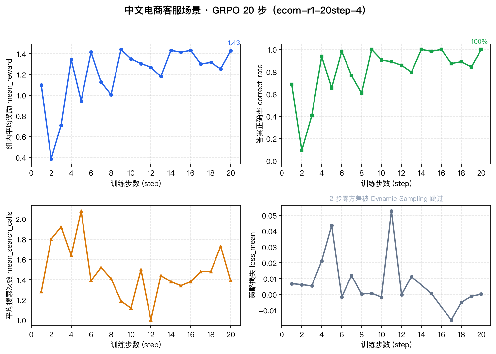
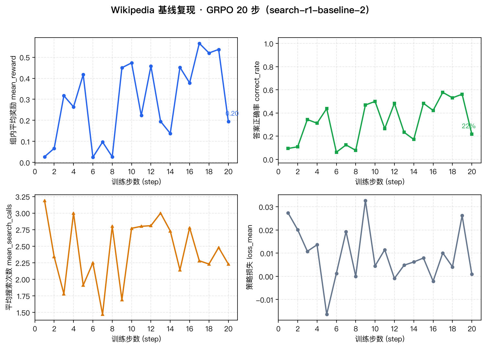

# Ecom Search-R1 · GRPO 训练的中文电商检索增强客服 Agent

用 **GRPO 强化学习**训练 Qwen3.5-4B，让模型在多轮对话中**自主决定何时搜索、搜什么、何时作答**，并输出**可溯源引用**——在自建的中文电商客服场景上，EM 从 41.9% 提升到 **91.6%**（多跳题 +74.4pp），且引用**零编造**。

这个仓库不止是「跑了个 RL」：完整的链路是 **base → SFT 冷启动（拒绝采样）→ GRPO**，并且**对奖励函数本身做了归因**——用落盘的真实轨迹量化出「哪个奖励分项真的在产生梯度、哪个只是摆设」。后者比涨点更能说明问题，详见 [奖励项归因](#奖励项归因05-的引用权重里有多少真的在起作用)。

**个人独立完成的核心工作**：

- **场景改造与数据构建**：将英文 Wikipedia 问答管线改造为中文电商客服——**全代码生成** 36 篇虚构品牌文档（28 商品手册 + 8 服务政策）+ 204/70 训练评测集，每题带 `gold_docs` 标注答案依据
- **本地检索环境**：Qdrant 嵌入式向量库 + `BGE-small-zh-v1.5` 中文向量模型，检索结果带 Doc-ID 回显供模型引用
- **奖励设计 + 奖励归因**：引用可溯源复合奖励（EM + 引用存在 + 引用真实检索校验 + gold 命中 − 搜索成本），并用反事实重打分量化每个分项的真实梯度贡献（[`reward_ablation.py`](reward_ablation.py)）
- **SFT 冷启动**：拒绝采样筛出「答案对 + 引用对」的轨迹做冷启动，**通过率本身就是难度分层**（[`sft.py`](sft.py)）
- **训练与双评测**：PyTRIO 远端 GRPO 训练，Base vs Step-20 各 70 题 × 15 指标全量评测（原始记录见 `eval_result/`）
- **部署压测**：把 4B 策略服务化，vLLM vs HF generate 的并发吞吐 / TTFT / 尾延迟对比（[`bench_serving.py`](bench_serving.py)）
- **管线验证**：先在 Wikipedia 场景完整跑通原实验作为改造前的正确性基线（EM 27.1%→31.4%，多跳 HotpotQA +20pp）

> 基于 [KMnO4-zx/agentic-rl-lab](https://github.com/KMnO4-zx/agentic-rl-lab)（Apache-2.0）的 03-search-r1 实验框架扩展；相对原仓库修改/新增的文件在目录结构中以 ★ 标注。

## 结果速览

### 电商客服场景（核心工作，本地 Qdrant 检索，70 题固定评测集）

| 指标 | Base Model | RL Step-20 | 变化 |
|---|---|---|---|
| **EM（宏平均）** | 41.9% | **91.6%** | **+49.8pp** |
| 多跳题 EM（需 ≥2 次检索） | 15.4% | **89.7%** | **+74.4pp** |
| 政策类题 EM（保修/物流/退换） | 25.0% | **100.0%** | +75.0pp |
| 单跳题 EM | 85.2% | 85.2% | **持平（见下）** |
| 格式合法率（Answer+Source） | 98.6% | **100.0%** | +1.4pp |
| 引用存在率 | 98.6% | **100.0%** | +1.4pp |
| **引用真实检索率（防编造）** | 98.6% | **100.0%** | +1.4pp |
| 引用 gold 命中率 | 92.9% | 92.9% | **持平（见下）** |
| 平均搜索次数 | 1.44 | 1.56 | 多跳检索更充分，成本可控 |

核心结论：RL 训练后模型学会了**多轮检索再作答**——多跳题（先查商品、再查政策）提升 +74.4pp，且**所有引用编号均真实来自检索结果**（零编造），格式 100% 合规。

**两个「没动」的数字比涨点更有信息量**：

1. **单跳题 85.19% → 85.19%，一分不涨**：当时的解释是「base 已经会的题 RL 不碰」。**后来发现这个解释不完整**——真正的瓶颈在检索器 top-k（[下一节](#检索器-top-k-消融残留错题的瓶颈不在策略在召回)）。把 top-k 从 3 提到 8、模型完全不动，单跳题立刻从 85.19% 涨到 **100%**。
2. **引用 gold 命中率卡在 92.86% 不随训练变化**：既不是噪声也不是「权重太弱」——[奖励项归因](#奖励项归因05-的引用权重里有多少真的在起作用) 用反事实重打分证明它与 EM 的排序几乎完全一致（φ 从 0.240 升到 0.598），且**可优化空间只剩 1 道题**；而 top-k 消融进一步说明**另一半原因同样是召回**。

## 检索器 top-k 消融：残留错题的瓶颈不在策略，在召回

### 起因

上面两个「训练前后完全不动」的数字（单跳 `em/single` 85.19%、`citation/source_gold` 92.86%），把残留错题的 `retrieved_doc_ids` 与 `gold_docs` 对起来查，**5 道错题 5/5 都是「该看的文档压根没被检索出来」**——线上每次只返回 3 篇。36 篇文档结构完全同构（每篇都有「售价：…」），`bge-small-zh-v1.5` 区分不开，目标文档排不进 top-3。

### 第一步：离线量化召回上限（`ecommerce/retrieval_recall.py`，不需要模型）

用问题原文当 query 扫 top-k，看 gold 是否被召回：

| k | 全部命中 gold | 至少命中一篇 |
|---|---|---|
| 1 | 32.9% | 71.4% |
| **3（线上配置）** | **60.0%** | 87.1% |
| 5 | 74.3% | 95.7% |
| **8** | **90.0%** | 100% |
| 16 | 100% | 100% |

5 道已知错题的 gold 排序位置：`ecom_0065→6`、`ecom_0093→3`、`ecom_0106→5`、`ecom_0050→5`、`ecom_0226→8,9`。

### 第二步：单变量对照（只改 top_k，模型完全不动）

`eval.py --top-k 8`，其余参数与原始 base 评测完全一致：

| 指标 | base · top_k=3 | base · top_k=8 | Δ |
|---|---|---|---|
| **EM（宏平均）** | 41.86% | **54.49%** | **+12.63pp** |
| 单跳 `em/single` | 85.19% | **100.0%** | **+14.81pp** |
| 多跳 `em/multihop` | 15.38% | **38.46%** | **+23.08pp** |
| 政策 `em/policy` | 25.0% | 25.0% | **0**（见结论 2） |
| `citation/source_gold` | 92.86% | **100.0%** | **+7.14pp** |
| `format/rate` | 98.57% | 100.0% | +1.43pp |
| `search/results` | 3.0 | 8.0 | 配置已生效 |

### 三条结论

1. **诊断成立**：单跳 85.19% → 100%、`source_gold` 92.86% → 100%——这两个「冻住」的指标其实是**同一件事**：gold 文档排不进 top-3。**奖励给得再高，也换不出一个根本没被检索到的文档。**
2. **policy 题不涨是必要的反例**：政策类只有 4 道，离线实验显示 k=3 时召回率已经 100%，所以它的问题是推理而不是检索。**修复只对「召回不足」的题有效**——这说明诊断有边界，不是一个万能解释。
3. **原始 baseline 被低估了**：`41.86% → 91.64%` 的 +49.8pp 里，**有 12.63pp 其实来自检索器配置，而不是 RL**。把检索器统一到 top_k=8 之后，RL 的真实增益才可比。

> 复现：`SEARCH_R1_SCENE=ecommerce SEARCH_R1_EVAL_DATA=$PWD/datasets/ecommerce/dev.jsonl uv run python eval.py --search-backend ecommerce --top-k 8 --output eval_result/ecom_eval_base_topk8.jsonl`

### Wikipedia 场景（改造前的管线验证基线，Wikipedia 免费后端，70 题固定评测集）

| 指标 | Base Model | RL Step-20 | 变化 |
|---|---|---|---|
| EM（宏平均） | 27.1% | **31.4%** | +4.3pp |
| HotpotQA 子集 EM | 30.0% | **50.0%** | +20pp |
| 2WikiMultiHopQA EM | 0.0% | **10.0%** | +10pp |
| 格式合法率 | 50.0% | **70.0%** | +20pp |
| 平均搜索次数 | 2.93 | 2.59 | 搜索更高效 |

## 奖励项归因：0.5 的引用权重里有多少真的在起作用

电商场景的复合奖励有 4 个正分项：

$$r = 1.0 \cdot \text{EM} + \underbrace{0.1}_{\text{有引用}} + \underbrace{0.2}_{\text{引用真实检索}} + \underbrace{0.2}_{\text{引用命中 gold}} - 0.05 \cdot \min(\text{搜索次数}, 4)$$

「引用 gold 命中率不涨」的自然怀疑是「那 0.2 权重太弱」。但真实原因不是权重弱。`reward_ablation.py` 对 `eval_result/` 里 70 条落盘轨迹做反事实重打分（先把每项权重单独置 0，再看奖励景观怎么变），判据是 **GRPO 的组内中心化**：

```python
advantage_i = reward_i − mean(reward_group)   # rollout.assign_group_advantages
```

因此**任何在同一组内恒为常数的分项，对 advantage 的贡献恒为 0**。于是「把某项权重置 0 后，70 题两两之间的相对顺序有没有变」就成了「这项到底有没有在产生梯度」的判据。

### 归因结果（`uv run python reward_ablation.py`，可复现）

| 预设（置 0 的项） | 奖励数值变动题数 | **题对顺序变动数** | 判定 |
|---|---|---|---|
| `no_has_source`（−0.1） | 70 / 70 | **0** | **仅全局常数偏移 → 组内零梯度** |
| `no_source_retrieved`（−0.2） | 70 / 70 | **0** | **仅全局常数偏移 → 组内零梯度** |
| `no_source_gold`（−0.2） | 65 / 70 | 49 | 有信号，但只来自 5 道题 |
| `no_search_penalty` | 70 / 70 | 927 | 真实起作用（约束检索成本） |
| `em_only` | 70 / 70 | 1004 | 真实起作用 |

跨 checkpoint 对照（触发率）：

| 分项 | Base | Step-20 | Δ |
|---|---|---|---|
| EM | 42.86% | 88.57% | +45.71% |
| 有引用 | 98.57% | 100.00% | +1.43% |
| 引用真实检索 | 98.57% | 100.00% | +1.43% |
| **引用命中 gold** | **92.86%** | **92.86%** | **+0.00%** |
| 搜索惩罚 | 100.00% | 100.00% | +0.00% |

EM × 引用命中 gold 列联表（Step-20，n=70）：

| | 引用对 | 引用错 |
|---|---|---|
| **EM=1** | 61 | **1** ← 引用项唯一真正惩罚的「答对却引错」 |
| **EM=0** | 4 | 4 |

（Base 阶段：EM=1 且引用错 = **0 题**；EM=0 但引用对 = 35 题。）

### 三条结论

1. **0.3 的引用权重（有引用 0.1 + 引用真实检索 0.2）严格不产生梯度。** 置 0 后每题奖励都变了，但题对顺序一对没变——它只贡献了一个全局常数偏移。这两项作为「防编造引用的硬约束」仍然该保留，但**不该指望它带来任何学习信号**。
2. **`source_gold` 卡死的原因是指标饱和，不是权重太弱。** 它在两个 checkpoint 上触发率完全相同（92.86%），而同期 EM 从 42.86% 涨到 88.57%。于是它与 EM 的 φ 相关系数从 **0.240 升到 0.598**——从「与 EM 弱相关」变成「几乎被 EM 决定」，独立贡献被 EM 吸收掉大半。
3. **可优化空间只剩 1 道题。** Step-20 上「答案对但引用错」只有 **1 题**（base 阶段是 0 题）。这项奖励在起点就已接近天花板，给再多权重也不会动。

这条负结果和本工作另一个项目（从零手写 GRPO/DAPO 的消融诊断）里 `clip_fraction ≡ 0`（非对称 clip 机制从未触发）是**同一族失效的两种形态**：一个是「机制没触发」，一个是「指标已饱和」，共同主题是——**配置里打开的开关 ≠ 实际生效的机制**。

复现：`python reward_ablation.py`（纯离线，不需 GPU 与 PyTRIO，结果落 `eval_result/reward_ablation.json`）。

### 怎么用它做真正的消融

归因是**离线观测**，要拿「重训后的因果结论」需把权重做成可切换的：

```bash
# 逐个切换奖励预设重训，其余超参完全一致
for cfg in full no_source_gold no_source_retrieved no_citation em_only; do
  SEARCH_R1_SCENE=ecommerce uv run python train.py \
      --reward-config "$cfg" --max-steps 20 --save-every 5 \
      --data datasets/ecommerce/train.jsonl --search-backend ecommerce \
      --run-name "abl-$cfg"
done
```

所有可选项见 `reward.REWARD_PRESETS`（`python -c "from reward import REWARD_PRESETS; print(*REWARD_PRESETS)"`）。

## SFT 冷启动：补上 base → SFT → RL 的中间那一段

原实验链路是 `base → RL`。被问「你为什么要做 RL？SFT 做到头了吗？」时，只有 RL 前后两个点，答不上来。`sft.py` 补上标准三段式：

```
base  →  SFT（拒绝采样冷启动）  →  RL（GRPO + 可溯源奖励）
```

设计参考 Alibaba-NLP/DeepResearch 的 WebDancer / WebSailor 两阶段 recipe：**先用当前策略对同一道题采样多条轨迹，只保留完全正确的（rejection sampling），把保留轨迹当示范做 SFT；再用 RL 去攻那些筛不出来的难题。**

```bash
SEARCH_R1_SCENE=ecommerce uv run python sft.py \
    --data datasets/ecommerce/train.jsonl --search-backend ecommerce \
    --questions 60 --samples-per-question 4 --min-reward 1.0 --epochs 2 \
    --run-name ecom-sft-coldstart
# 输出 sft_runs/<run-name>/ 下的 state 路径，然后接 RL：
SEARCH_R1_SCENE=ecommerce uv run python train.py \
    --resume-state '<上一步的 state 路径>' \
    --max-steps 20 --search-backend ecommerce --run-name ecom-sft-then-rl
```

**关键设计：拒绝采样通过率本身就是难度分层。** 脚本写出的 `rejection_stats.json` 给出每道题的轨迹通过率：

| 通过率 | 含义 | 用途 |
|---|---|---|
| = 0 | base 完全做不出 | SFT 学不到，**留给 RL 主攻** |
| ∈ (0, 1) | 有对有错 | **SFT 的黄金样本** |
| = 1 | base 已经会 | 对 SFT 与 RL 都几乎无增益（呼应单跳题 85.2%→85.2% 的持平） |

这就是「数据环节里自己设计的那一步」，而不是「直接下载开源数据集」。

> `min-reward ≥ 1.0` 等价于「答案对且引用全对」：答案错时最多只能拿到 0.5 的引用分（0.1+0.2+0.2），达不到 1.0。

### 实测结果：SFT 的天花板在哪里（60 题 × 4 采样，`sft_runs/ecom-sft-coldstart/`）

采样 **240** 条轨迹 → 通过 **109** 条（45.4%）；SFT loss 0.0237 → 0.0240（两个 epoch 基本不再下降）。

按题型拆开看，**这就是「为什么必须做 RL」的量化证据**：

| 题型 | 题数 | 通过率均值 | hard(=0) | golden(∈(0,1)) | easy(=1) |
|---|---|---|---|---|---|
| 单跳 `ecommerce_single` | 26 | **0.885** | 3 | 0 | **23** |
| 多跳 `ecommerce_multihop` | 31 | **0.105** | **20** | 11 | 0 |
| 政策 `ecommerce_policy` | 3 | 0.333 | 1 | 2 | 0 |
| **合计** | 60 | — | **24** | **13** | **23** |

三条推论，一条比一条硬：

1. **SFT 的增益空间只有 13/60 = 21.7%** —— 能学会的题（golden）一共 13 道。
2. **单跳题 88% 通过率 = 1，SFT 无事可做** —— 这直接解释了评测里单跳 `em/single` 从 85.19% 到 85.19% 一分没涨：**不是训练没跑，是这批题 base 早就饱和了**。
3. **多跳题 65% 通过率 = 0，SFT 也学不会**（拒绝采样拿不到任何正例）—— 只能靠 RL 用奖励信号去探索，而 RL 确实把多跳从 **15.38% 拉到 89.74%**。

> 换句话说：**SFT 能解决的（easy 23 题）base 早就解决了；base 解决不了的（hard 24 题）SFT 也解决不了。**
> 三段式的价值不在「SFT 涨了多少」，而在**用 13/60 这个数字说明了 SFT 已经到顶**，后面的增益必须由 RL 提供。

## 推理部署压测（Kaggle T4 ×2，`kaggle_bench_serving.ipynb`）

这一节补的是 **403 条真实 JD 正文里提及率 37.2%（Agent 岗 49%）的「部署」** —— 三个项目里唯一全空的一块。

**HF `generate` 基线实测**（`Qwen/Qwen3.5-4B`，`--max-new-tokens 128`，T4 只支持 fp16）：

| 并发(=batch) | 吞吐 tok/s | 延迟 p95 (s) |
|---|---|---|
| 1 | 9.6 | 13.318 |
| 2 | 9.0 | 14.273 |
| 4 | 17.0 | 7.551 |
| 8 | **30.5** | **4.200** |

读法：HF 的 `generate` **没有连续批处理**，只能整批前向，所以 `concurrency` 实为 batch size，
p95 是「整批墙钟 ÷ 请求数」的摊销值，不是单请求延迟 —— 这点必须自己讲清楚，否则会被面试官纠正。
吞吐从 1 到 8 路只涨 3.2 倍，说明**朴素 HF 部署的扩展性有限**，这正是引入 vLLM 的动机。

⚠️ **vLLM 两个后端在本轮 Kaggle 环境中没跑通**，不是脚本问题：Kaggle 镜像里
`torch 2.9.0+cu130` 与 `torchaudio 2.9.0+cu128` 的 CUDA 版本不一致，`transformers.audio_utils`
无条件 `import torchaudio` 时直接抛 `RuntimeError: ... compiled with different CUDA versions`。
notebook 的 Cell 5 已加**自动对齐**（按 `torch.version.cuda` 重装匹配的 torchaudio）并做 import 验收。

> 原则：**vLLM 没跑通就只写 HF 基线的真实数字 + 说明环境原因**，不编「加速 N 倍」。

## 这个仓库本身就是一个 agentic RL 环境

「Agent + RL」是当前最热的细分方向，而它的核心工程件不是一个 prompt 编排层，而是**一个多轮可交互、奖励可验证、轨迹可回放的环境**。本仓库的组件恰好就是这个结构：

| 标准 agentic RL 框架的分层 | 本仓库对应文件 | 作用 |
|---|---|---|
| Environment / Tools | `search.py`（`ecommerce` 后端，Qdrant 本地向量检索） | 模型可调用的检索工具，返回带 Doc-ID 的观测 |
| Multi-turn rollout | `rollout.py` | 多轮「生成 → 解析 tool_call → 执行 → 拼接下一轮 prompt」的轨迹采样 |
| Verifiable reward | `reward.py` | 不需要奖励模型：答案 EM + 引用可溯源，全部可规则判定 |
| Policy optimization | `train.py` | 组内相对优势（GRPO）+ 动态 micro-batch 装箱 |
| Diagnostics | `reward_ablation.py` / `analyse.py` | 奖励项归因、逐题 badcase 复查 |

把它对齐到 RAGEN / verl-agent 的目录约定（`environments/ memory/ multi_turn_rollout/ reward_manager/`）是后续升级路径——**而不是**在上面再叠一层确定性 prompt 编排（那种「七阶段 harness」不训模型、只会让技术栈变杂）。

## 目录结构

```
├── train.py            # GRPO 训练（PyTRIO 远端，本地只做数据组装）★
├── sft.py              # SFT 冷启动：拒绝采样 + assistant-only 交叉熵 ★新增
├── eval.py             # 统一评测器：base / checkpoint 共用，支持电商指标 ★
├── rollout.py          # 多轮 rollout：搜索工具调用 + 轨迹记录（含 retrieved_doc_ids）★
├── search.py           # 搜索后端：deepseek / wikipedia / zhihu / ecommerce(Qdrant) ★
├── protocol.py         # 双场景协议：英文 Wiki 问答 / 中文电商客服 ★
├── reward.py           # 奖励：原版 EM/Format + 电商引用可溯源复合奖励（权重可配置）★
├── reward_ablation.py  # 奖励项归因：反事实重打分，量化每个分项的梯度贡献 ★新增
├── bench_serving.py    # 部署压测：vLLM vs HF generate 的吞吐 / TTFT / 尾延迟 ★新增
├── data.py             # 数据加载（含 gold_docs 字段）★
├── prepare_data.py     # Wikipedia 数据准备（原始 lab 既有）
├── analyse.py          # 评测结果分析（原始 lab 既有）
├── plot_curves.py      # 从训练日志重绘训练曲线（本 README 图表可复现）★
├── tests/
│   └── test_reward.py  # 奖励自检：用落盘的真实轨迹把奖励公式钉死 ★新增
├── ecommerce/
│   ├── build_data.py   # 电商文档库 + 训练/评测集生成（seed=42 全代码生成）★
│   └── index_qdrant.py # BGE 向量化入库本地 Qdrant ★
├── datasets/
│   └── ecommerce/      # 电商文档与训练/评测数据（train 204 / dev 70）
├── eval_result/        # 全部评测原始记录 + 奖励归因结果（JSONL / JSON，可复查）
└── docs/
    ├── images/         # 训练曲线图（由 plot_curves.py 生成）等配图
    └── training_data/  # 从训练日志提取的逐步指标（图表数据源，与 SwanLab 同源）
```

标 ★ 的文件相对原仓库做了场景扩展修改；未标注的为原仓库代码。

## 快速开始

### 环境

```bash
# 需要 Python >= 3.13 + uv
uv sync

# PyTRIO 账号（远端训练与采样）：https://pytrio.com
# 首次使用：pytrio login（密钥保存在 ~/.pytrio/config.toml）

# 搜索后端密钥（仅 deepseek/zhihu 后端需要，wiki/ecommerce 后端免费）
cp .env.example .env

# 跑自检（不需要 GPU / PyTRIO）
uv run --extra dev pytest tests/ -q
```

### 电商场景（核心工作）

```bash
# 1.（可选）重建数据集——仓库已附带 datasets/ecommerce/，可跳过
uv run python ecommerce/build_data.py
# 2. 建向量库（首次运行自动下载 BGE 模型，约 90MB）
uv run python ecommerce/index_qdrant.py

# 3.（可选）SFT 冷启动，产出 state 供下一步 --resume-state
SEARCH_R1_SCENE=ecommerce uv run python sft.py \
    --data datasets/ecommerce/train.jsonl --search-backend ecommerce \
    --questions 60 --samples-per-question 4 --run-name ecom-sft-coldstart

# 4. 训练：20 步 GRPO
SEARCH_R1_SCENE=ecommerce uv run python train.py \
    --max-steps 20 --save-every 5 \
    --data datasets/ecommerce/train.jsonl \
    --search-backend ecommerce \
    --run-name ecom-r1-20step

# 5. 评测：Base vs Step-20 各跑一次 70 题
SEARCH_R1_SCENE=ecommerce \
SEARCH_R1_EVAL_DATA=$PWD/datasets/ecommerce/dev.jsonl \
uv run python eval.py --search-backend ecommerce \
    --output eval_result/ecom_eval_base.jsonl

SEARCH_R1_SCENE=ecommerce \
SEARCH_R1_EVAL_DATA=$PWD/datasets/ecommerce/dev.jsonl \
uv run python eval.py --search-backend ecommerce \
    --model-path 'trio://<你的-step-20-weights-路径>' \
    --output eval_result/ecom_eval_step20.jsonl

# 6. 奖励项归因（纯离线，读上一步的评测文件）
uv run python reward_ablation.py

# 7. 部署压测（需要 GPU + vllm；没有本地 GPU 就用 kaggle_bench_serving.ipynb）
uv run python bench_serving.py --backend server --concurrency 1 2 4 8 16
uv run python bench_serving.py --backend hf --concurrency 1 2 4 8
```

> **哪些脚本需要本地 GPU？** 只有 `bench_serving.py`。`train.py` / `sft.py` / `eval.py`
> 只在本机做数据与轨迹编排，真正的训练和采样由远端 PyTRIO 服务执行，因此**不需要本地 GPU**
> （但需要一个可用的 PyTRIO API key，以及本地的 Qdrant 索引）。
> `bench_serving.py` 请用仓库里的 `kaggle_bench_serving.ipynb` 在 Kaggle T4 上跑。

### Wikipedia 场景（管线验证基线）

```bash
# 1. 准备数据（下载 wiki dump 并生成 train/dev/test，详见 docs/lab-readme.md）
uv run python prepare_data.py

# 2. 训练（免费 wikipedia 后端）
uv run python train.py --max-steps 20 --save-every 5 \
    --search-backend wikipedia --run-name search-r1-wiki

# 3. 评测
SEARCH_R1_EVAL_DATA=$PWD/datasets/dev.jsonl \
uv run python eval.py --search-backend wikipedia \
    --output eval_result/eval_results_base_wiki.jsonl
```

> 注：`docs/` 内是原 lab 的教程文档，其中命令以原仓库根目录运行（带 `03-search-r1/` 前缀）；在本仓库中请去掉该前缀、从仓库根目录运行。

## 评测指标说明

| 指标 | 含义 |
|---|---|
| `em/macro` | 各数据源 Exact Match 的宏平均 |
| `em/{single,policy,multihop}` | 按题型拆分的 EM（单跳 / 政策 / 多跳） |
| `format/rate` | 输出格式合法率（电商场景 = Answer + Source 两行齐全） |
| `citation/has_source` | 给出引用行的比例 |
| `citation/source_retrieved` | 引用编号真实出现在本轮检索结果中的比例（防编造引用） |
| `citation/source_gold` | 引用编号命中 gold docs 的比例（引对了来源） |
| `rollout/search_calls` | 平均搜索次数（效率） |
| `search/*` | 检索成功率 / 超时率 / 429 率 / 平均延迟 |

## 训练曲线

图表由 [`plot_curves.py`](plot_curves.py) 从训练日志提取的逐步指标重绘（数据与 SwanLab 云端同源，可复现）。

### 电商场景（ecom-r1-20step-4）



- **正确率**：step 2 短暂触底 9.4%（首次策略更新后的格式震荡）后快速爬升，step 9 起稳定在 85%–100% 区间，step 20 收敛至 100%
- **奖励**：收敛到 ~1.43，贴近复合奖励的理论上限（1.0 EM + 0.5 引用项 − 搜索成本），说明各奖励分量同时被满足
- **搜索次数**：稳定在 1.4 次/题附近——搜索成本惩罚生效，单跳题不过度搜索，多跳题自动补搜
- 2 个 step 的 loss 显示为跳过：该步全组零方差（全对/全错），被 Dynamic Sampling 机制跳过，不产生梯度

### Wikipedia 基线（search-r1-baseline-2，改造前管线验证）



- 训练信号方向正确（奖励 0.03 → 0.5+），但组级方差大：每步仅 64 条 rollout，Wikipedia 多跳任务对 4B 模型难度高，逐步正确率在 6%–58% 间震荡
- 因此最终成绩以 70 题固定评测集的双评测为准（EM 27.1%→31.4%），而非训练期滚动指标

**在线曲线**（含完整超参配置与更多指标面板）：
- 电商 run：[SwanLab · ecom-r1-20step-4](https://swanlab.cn/@rickena/agentic-rl-lab-search-r1/runs/cze9su7x)
- Wiki 基线 run：[SwanLab · search-r1-baseline-2](https://swanlab.cn/@rickena/agentic-rl-lab-search-r1/runs/pjirsjub)

## 致谢与许可

- 原仓库：[KMnO4-zx/agentic-rl-lab](https://github.com/KMnO4-zx/agentic-rl-lab) —— 实验框架、训练/评测流程与其教程（见 `docs/`）
- 训练基建：[PyTRIO](https://pytrio.com)；实验跟踪：[SwanLab](https://swanlab.cn)；向量检索：[Qdrant](https://qdrant.tech) + [BGE](https://huggingface.co/BAAI/bge-small-zh-v1.5)
- 许可：Apache-2.0（沿用原仓库）
