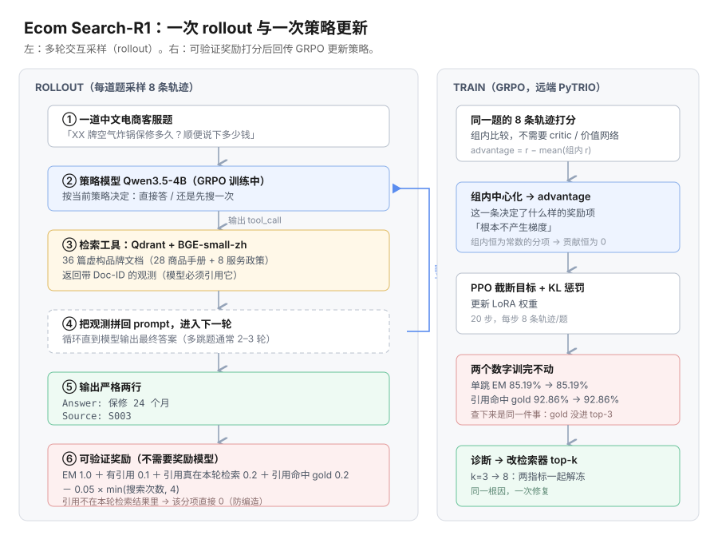

<div align="center">

# Ecom Search-R1

**中文电商客服 Agent。用 GRPO 训练 Qwen3.5-4B 学会「何时检索、搜什么」，回答必须带出处。**

<a href="https://pytrio.com"></a>
<a href="https://swanlab.cn"></a>
<a href="https://qdrant.tech"></a>


</div>

## 这是什么

用户问「XX 牌空气炸锅保修多久，多少钱」，模型自己判断要不要查商品文档，查到什么就答什么，答案末尾必须给出处编号。

商品文档里的品牌全是虚构的（6 个牌子、36 篇文档），模型预训练里没见过，答对只能靠检索。每题带 `gold_docs` 标注答案依据在哪几篇，所以「引用是否真实」可以自动判分。



## 结果

电商场景，本地 Qdrant 检索，70 题固定评测集：

| 指标 | Base | RL Step-20 | 变化 |
|---|---|---|---|
| EM（宏平均） | 41.9% | 91.6% | +49.8pp |
| 多跳题 EM（需 ≥2 次检索） | 15.4% | 89.7% | +74.4pp |
| 政策类题 EM（保修/物流/退换） | 25.0% | 100.0% | +75.0pp |
| 单跳题 EM | 85.2% | 85.2% | 持平 |
| 格式合法率（Answer + Source 两行齐全） | 98.6% | 100.0% | +1.4pp |
| 引用存在率 | 98.6% | 100.0% | +1.4pp |
| 引用真实检索率（防编造） | 98.6% | 100.0% | +1.4pp |
| 引用命中 gold | 92.9% | 92.9% | 持平 |
| 平均搜索次数 | 1.44 | 1.56 | |

有两个数字训练前后完全不动（单跳 EM 85.2%、引用命中 gold 92.9%）。查下来是同一件事：检索器 top-k=3 召回不够，gold 文档排不进前三。把 k 提到 8、模型权重完全不动，单跳 EM 直接到 100%。过程和对照实验见 [检索器 top-k 消融](docs/retrieval-ablation.md)。

## 快速开始

```bash
# 需要 Python >= 3.13 和 uv
uv sync

# 建本地向量库（首次会自动下载 BGE 模型，约 90MB）
uv run python ecommerce/index_qdrant.py

# 跑自检，不需要 GPU
uv run --extra dev pytest tests/ -q

# 20 步 GRPO 训练（GPU 在远端 PyTRIO）
SEARCH_R1_SCENE=ecommerce uv run python train.py \
    --max-steps 20 --save-every 5 \
    --data datasets/ecommerce/train.jsonl \
    --search-backend ecommerce \
    --run-name ecom-r1-20step

# 评测：base 与 checkpoint 各跑 70 题
SEARCH_R1_SCENE=ecommerce SEARCH_R1_EVAL_DATA=$PWD/datasets/ecommerce/dev.jsonl \
uv run python eval.py --search-backend ecommerce --output eval_result/ecom_eval_base.jsonl
```

训练和采样走远端 PyTRIO，需要一个 API key（`pytrio login`，密钥存在 `~/.pytrio/config.toml`）。本机只做数据组装和本地检索，不需要 GPU。

**唯一需要 GPU 的脚本是 `bench_serving.py`**（推理部署压测），用仓库里的 `kaggle_bench_serving.ipynb` 在 Kaggle T4 上跑。本地是 macOS，没有 CUDA。

## 我做了什么

基于 [KMnO4-zx/agentic-rl-lab](https://github.com/KMnO4-zx/agentic-rl-lab)（Apache-2.0）的 03-search-r1 实验框架扩展。相对原仓库新增或修改的文件在目录结构里用 ★ 标出，其余是原仓库代码。

分工上，原仓库给的是英文 Wikipedia 问答的骨架，我做的是：

- 把场景换成中文电商客服，自己生成 36 篇商品文档和 204/70 的训练评测集（`ecommerce/build_data.py`，seed=42 纯代码生成，每题带 `gold_docs` 标注答案依据）
- 接了本地检索环境：Qdrant 嵌入式向量库 + `BGE-small-zh-v1.5`，检索结果带 Doc-ID 回显，供模型引用
- 设计了引用可溯源的复合奖励，并且用反事实重打分量化每个奖励分项实际产生了多少梯度（`reward.py`、`reward_ablation.py`）
- 补了 SFT 冷启动环节（拒绝采样），把 base → SFT → RL 的三段式补齐（`sft.py`）
- 跑了检索器 top-k 消融，定位残留错题的瓶颈（`ecommerce/retrieval_recall.py`）
- 做了推理部署压测（`bench_serving.py`）

## 项目结构

```
├── train.py            # GRPO 训练（PyTRIO 远端，本地只做数据组装）★
├── sft.py              # SFT 冷启动：拒绝采样 + assistant-only 交叉熵 ★新增
├── eval.py             # 统一评测器：base / checkpoint 共用，支持电商指标 ★
├── rollout.py          # 多轮 rollout：搜索工具调用 + 轨迹记录（含 retrieved_doc_ids）★
├── search.py           # 搜索后端：deepseek / wikipedia / zhihu / ecommerce(Qdrant) ★
├── protocol.py         # 双场景协议：英文 Wiki 问答 / 中文电商客服 ★
├── reward.py           # 奖励：原版 EM/Format + 电商引用可溯源复合奖励（权重可配置）★
├── reward_ablation.py  # 奖励项归因：反事实重打分，量化每个分项的梯度贡献 ★新增
├── bench_serving.py    # 部署压测：vLLM vs HF generate 的吞吐 / TTFT / 尾延迟 ★新增
├── data.py             # 数据加载（含 gold_docs 字段）★
├── prepare_data.py     # Wikipedia 数据准备（原仓库既有）
├── analyse.py          # 评测结果分析（原仓库既有）
├── plot_curves.py      # 从训练日志重绘训练曲线 ★
├── tests/
│   ├── test_reward.py  # 奖励自检：用落盘的真实轨迹把奖励公式钉死 ★新增
│   └── test_cli.py     # CLI 参数自检：抓「用了但没定义的参数」 ★新增
├── ecommerce/
│   ├── build_data.py       # 电商文档库 + 训练/评测集生成（seed=42 全代码生成）★
│   ├── index_qdrant.py     # BGE 向量化入库本地 Qdrant ★
│   └── retrieval_recall.py # 检索召回上限扫描（纯离线，不需要模型）★新增
├── datasets/ecommerce/ # 电商文档与训练/评测数据（train 204 / dev 70）
├── eval_result/        # 全部评测原始记录 + 奖励归因结果（JSONL / JSON）
└── docs/
    ├── *.md            # 细节文档，见「文档」一节
    ├── images/         # 架构图、训练曲线
    └── training_data/  # 从训练日志提取的逐步指标（图表数据源，与 SwanLab 同源）
```

## 文档

| 主题 | 内容 |
|---|---|
| [检索器 top-k 消融](docs/retrieval-ablation.md) | 单变量对照，证明两个「冻住」的指标同一个根因 |
| [奖励项归因](docs/reward-attribution.md) | 反事实重打分，量化每个奖励分项实际产生了多少梯度 |
| [SFT 冷启动](docs/sft-cold-start.md) | 拒绝采样补齐 base → SFT → RL 三段式，测出 SFT 的天花板 |
| [推理部署压测](docs/serving-bench.md) | Kaggle T4 上的 HF 基线吞吐-并发曲线，以及 vLLM 没跑通的原因 |
| [代码结构对应 agentic RL 的哪些层](docs/agentic-rl-layers.md) | 环境 / 多轮 rollout / 可验证奖励 / 策略优化 / 诊断 |
| [Wikipedia 场景](docs/wikipedia-baseline.md) | 改造前先跑通原论文场景，作为管线基线 |
| [评测指标](docs/evaluation-metrics.md) | 各指标口径说明 |
| [训练曲线](docs/training-curves.md) | 电商与 Wiki 两条训练曲线 + SwanLab 链接 |

## 致谢与许可

- 原仓库：[KMnO4-zx/agentic-rl-lab](https://github.com/KMnO4-zx/agentic-rl-lab)，实验框架、训练评测流程与教程（见 `docs/`）
- 训练基建：[PyTRIO](https://pytrio.com)；实验跟踪：[SwanLab](https://swanlab.cn)；向量检索：[Qdrant](https://qdrant.tech) + [BGE](https://huggingface.co/BAAI/bge-small-zh-v1.5)
- 许可：Apache-2.0，沿用原仓库
